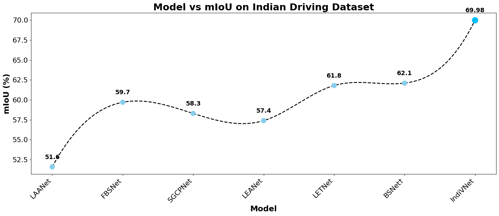
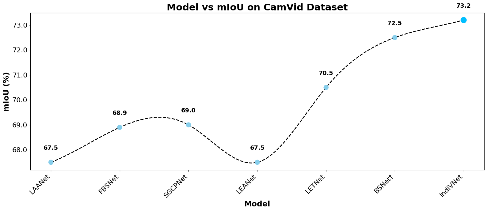
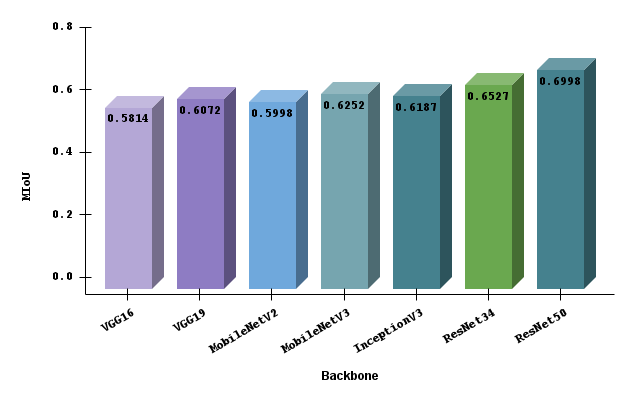
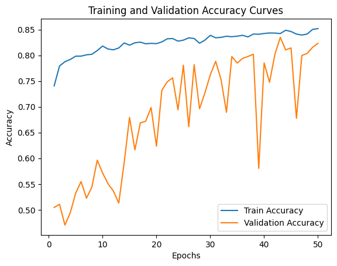
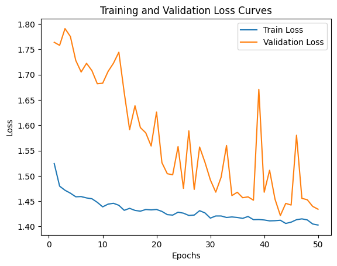

# IndiVNet: A Region Adaptive Semantic Image Segmentation for Autonomous Driving in Unstructured Environments

[](https://doi.org/10.1038/s41598-025-32305-2)
[](https://doi.org/10.1038/s41598-025-32305-2)
[](https://www.python.org/)
[](https://tensorflow.org/)
[](LICENSE.txt)
[](http://idd.insaan.iiit.ac.in/)

---

> **Official Implementation** of the paper:  
> **"IndiVNet: A region adaptive semantic image segmentation for autonomous driving in unstructured environments"**  
> *Pritam Chakraborty, Anjan Bandyopadhyay, Siddhartha Bhattacharyya, and Jan Platos*  
> Published in **Nature Scientific Reports** (2026) 16:2468 | [https://doi.org/10.1038/s41598-025-32305-2](https://doi.org/10.1038/s41598-025-32305-2)

---

## 📌 Table of Contents
- [Overview & Motivation](#-overview--motivation)
- [Key Contributions](#-key-contributions)
- [Architecture & Design](#-architecture--design)
  - [Feature Hierarchy](#1-feature-hierarchy-resnet-50-backbone)
  - [Indienco Custom Encoder](#2-indienco-progressive-dilation-encoder)
  - [Context-Spatial Fusion Decoder](#3-context-spatial-fusion-decoder)
  - [Mathematical Formulation](#4-mathematical-formulation)
- [Quantitative Benchmarks](#-quantitative-benchmarks)
  - [Performance on India Driving Dataset (IDD)](#1-performance-on-india-driving-dataset-idd)
  - [Cross-Domain Generalization on CamVid](#2-cross-domain-generalization-on-camvid)
  - [Comparison with Vision Transformers](#3-comparison-with-transformer-baselines)
  - [Multi-Criteria Decision Analysis (TOPSIS)](#4-multi-criteria-decision-analysis-topsis)
  - [Statistical Significance Testing](#5-statistical-significance-testing)
- [Ablation Studies & Sensitivity Analysis](#-ablation-studies--sensitivity-analysis)
  - [Component-wise Cumulative Ablation](#1-component-wise-cumulative-ablation)
  - [Backbone Architecture Comparison](#2-backbone-architecture-analysis)
  - [Dilation Rate Optimization](#3-dilation-rate-analysis)
  - [Kernel Size & Filter Depth](#4-kernel-size-and-filter-count-analysis)
- [Edge Case & Limitation Analysis](#-edge-case--limitation-analysis)
- [Qualitative Visualizations](#-qualitative-visualizations)
- [Repository Structure](#-repository-structure)
- [Getting Started](#-getting-started)
  - [Prerequisites](#1-prerequisites)
  - [Environment Setup](#2-environment-setup)
  - [Dataset Preparation](#3-dataset-preparation)
  - [Model Training](#4-model-training)
  - [Evaluation & Inference](#5-evaluation--inference)
- [Citation](#-citation)
- [Acknowledgements](#-acknowledgements)
- [License](#-license)

---

## 🔍 Overview & Motivation

Autonomous navigation systems heavily depend on dense, pixel-level semantic segmentation to understand surroundings and make split-second driving decisions. However, conventional state-of-the-art segmentation architectures (e.g., DeepLabV3+, BiSeNet, HRNet, SegFormer) are predominantly designed for and evaluated on structured Western datasets like **Cityscapes**, **CamVid**, and **BDD100K**.

When deployed in developing regions—especially on Indian roadways—these models suffer substantial performance degradation due to fundamental structural disparities:

1. **Heterogeneous Traffic Mix**: Unregulated co-existence of motor vehicles, two-wheelers, auto-rickshaws, pedestrians, bicycles, street vendors, and stray animals.
2. **Weak Lane & Boundary Infrastructure**: Unmarked roadways, eroded lane dividers, abrupt transitions between paved asphalt, gravel, and unpaved shoulders.
3. **Severe Visual Clutter & Dynamic Occlusions**: Dense crowding, roadside stalls, chaotic parking patterns, and frequent near-field occlusions.
4. **Extreme Intra-Class & Scale Variability**: High variance in vehicle geometries and appearances under fluctuating illumination and adverse weather.

To bridge this critical divide, **IndiVNet** introduces a lightweight yet high-capacity region-adaptive segmentation framework specifically engineered for chaotic, unstructured road environments while retaining real-time inference speed (15 FPS at 256×256) on resource-constrained embedded platforms.

---

## 🌟 Key Contributions

- **Novel Progressive Dilation Encoder (`Indienco`)**: Utilizes an incrementally expanding dilation schedule ($r \in \{6, 7, 8, \dots, 16\}$) that progressively broadens the receptive field (up to 33 px linear / 1089 px² area) while completely circumventing the grid effect and oversparsity common in standard dilated CNNs.
- **Context-Spatial Fusion Decoder**: Effectively bridges deep multi-scale semantic reasoning ($conv4\_block6$) with compressed, normalized low-level spatial features ($conv2\_block2$) via dual $3\times 3$ refinement modules to eliminate upsampling noise and delineate sharp object boundaries.
- **State-of-the-Art Accuracy on IDD**: Attains **69.98% mIoU** and **82.4% Dice Score**, outperforming leading lightweight models (BSNet, LETNet, FBSNet, SGCPNet) by **+7.88% to +18.38% mIoU** and surpassing complex Vision Transformers (MaskFormer, Swin-UNet, Segmenter).
- **Superior Cross-Domain Generalization**: Achieves **73.2% mIoU** on the CamVid benchmark, confirming that region-tailored multi-scale dilation transfers robustly to structured urban domains.
- **Proven Real-Time Feasibility**: Requires only **43.7M parameters**, **28.6 GFLOPs**, and **1.2 GB GPU memory**, executing at **15 FPS** on mid-range hardware.
- **Exhaustive Multi-Criteria & Statistical Validation**: Validated via paired t-tests ($p < 0.001$), Cohen’s Kappa ($\kappa = 0.851$, indicating almost perfect agreement), bootstrap confidence intervals, and TOPSIS multi-criteria ranking (ranked #1 with $C_i = 1.000$).

---

## 🏗️ Architecture & Design

IndiVNet adopts a hierarchical three-tiered encoder-decoder paradigm designed to strike an optimal equilibrium between global contextual reasoning and local boundary precision.


```
                       [ Input Image: 256 x 256 x 3 ]
                                     │
                         ┌───────────┴───────────┐
                         ▼                       ▼
            [ Low-Level Feature Map ]     [ High-Level Feature Map ]
               conv2_block2_out              conv4_block6_out
                 (64 x 64 x C)                 (16 x 16 x C)
                         │                               │
                Conv 1x1 (48/256 filters)                ▼
                  + BN + ReLU                  ┌───────────────────┐
                         │                     │  Indienco Encoder │
                         │                     │ - Global Avg Pool │
                         │                     │ - 1x1 Conv Path   │
                         │                     │ - Dilation 6 → 16 │
                         │                     └─────────┬─────────┘
                         │                               ▼
                         │                     Bilinear Upsample (4x)
                         │                         (64 x 64 x 256)
                         │                               │
                         └──────────────┬────────────────┘
                                        ▼
                                [ Concatenation ]
                                        │
                         ┌──────────────┴──────────────┐
                         ▼                             ▼
              [ Refinement Block 1 ]        [ Refinement Block 2 ]
              Conv 3x3 + BN + ReLU          Conv 3x3 + BN + ReLU
                         └──────────────┬──────────────┘
                                        ▼
                             Bilinear Upsample (4x)
                               (256 x 256 x 256)
                                        │
                               Conv 1x1 (n_classes)
                                 + Softmax / Sigmoid
                                        │
                                        ▼
                         [ Segmentation Mask: 256 x 256 ]
```

### 1. Feature Hierarchy (ResNet-50 Backbone)
A pretrained ResNet-50 backbone generates hierarchical multi-scale feature representations. Two complementary layers are tapped:
- **Low-level features ($F_{conv2} \in \mathbb{R}^{H/4 \times W/4 \times C}$)** from `conv2_block2_out`: Preserves high-frequency spatial details, fine textures, thin edges, and boundaries.
- **High-level features ($F_{conv4} \in \mathbb{R}^{H/16 \times W/16 \times C}$)** from `conv4_block6_out`: Encapsulates invariant global semantic representations of large scene entities (roads, sky, buildings, vehicles).

### 2. Indienco Progressive Dilation Encoder
Standard dilated convolution approaches apply isolated, large dilation rates (e.g., 6, 12, 18, 24) that cause severe filter sparsity and loss of small-scale context. The **Indienco** module solves this by progressively chaining dilation rates:
1. **Global Context Branch**: Average pooling across the spatial dimension, transformed via $1 \times 1$ conv + BN + ReLU, and bilinearly upsampled to restore original spatial size.
2. **Local Feature Branch**: Standard $1 \times 1$ convolution for immediate channel transformation.
3. **Progressive Dilation Stages ($r = 6, 7, \dots, 16$)**: At each successive stage, the input tensor is concatenated with the output of the preceding stage, passed through a $3 \times 3$ convolution at dilation rate $r$, and stabilized with Batch Normalization and ReLU.
4. **Channel Fusion**: The global pooling tensor, $1\times 1$ output, and all 11 dilated tensors are concatenated along the channel axis and projected through a $1 \times 1$ convolution to 256 output channels.

### 3. Context-Spatial Fusion Decoder
- **Low-level Refinement**: $F_{conv2}$ is passed through a $1\times 1$ conv (48/256 channels) + BN + ReLU to prevent low-frequency dominance over semantic context:
  $$F_{low} = \text{ReLU}\left(\text{BN}\left(\text{Conv}_{1\times 1}(F_{conv2})\right)\right)$$
- **Upsampling & Concatenation**: The Indienco representation is upsampled by $4\times$ to $(H/4, W/4)$ and concatenated with $F_{low}$:
  $$Z = \left[ Y^\uparrow_{indienco}, F_{low} \right]$$
- **Boundary Refinement**: Two sequential $3\times 3$ convolutional blocks with Batch Normalization and ReLU suppress interpolation artifacts and align spatial boundaries.
- **Prediction Head**: Bilinear upsampling by $4\times$ restores full $(H, W)$ resolution, followed by a $1\times 1$ convolution mapping to class logits.

### 4. Mathematical Formulation

#### Linear and Area Receptive Field
For a convolution kernel of size $k \times k$ with dilation rate $r$, the 1D linear receptive field extent $R_l$ and total 2D area receptive field $R_a$ are defined as:
$$R_l = k + (k - 1)(r - 1)$$
$$R_a = R_l^2 = \left(3 + 2(r - 1)\right)^2 \quad (\text{for } k=3)$$

For $r = 3$, a $3\times 3$ kernel yields an effective $7\times 7$ receptive field with only 9 trainable parameters instead of 49. In IndiVNet, varying $r$ from 6 to 16 dynamically scales the receptive field from 13 px up to 33 px (169 px² to 1089 px² area) without increasing parameter complexity.

#### Optimization Objective
IndiVNet minimizes the Categorical Cross-Entropy loss over smooth, everywhere-differentiable Softmax activations:
$$\mathcal{L}(y, \hat{y}) = -\sum_{i=1}^{N} y_i \log(\hat{y}_i), \quad \text{where} \quad \hat{y}_i = \frac{e^{z_i}}{\sum_j e^{z_j}}$$

---

## 📊 Quantitative Benchmarks

### 1. Performance on India Driving Dataset (IDD)
Evaluated on the finely annotated IDD test benchmark (10,003 images, 2,029 test set) with 95% bootstrap confidence intervals:

| Model | Input Resolution | Parameters (M) | FLOPs (G) | FPS (256×256) | Memory (GB) | mIoU (%) | Dice Score (%) |
| :--- | :---: | :---: | :---: | :---: | :---: | :---: | :---: |
| **IndiVNet (Ours)** | **256 × 256** | **43.7** | **28.6** | **15** | **1.2** | **69.98 ± 0.2** | **82.4 ± 0.3** |
| BSNet | 720 × 960 | 41.1 | — | 11 | — | 62.10 ± 0.4 | 76.7 ± 0.4 |
| LETNet | 360 × 480 | — | — | 14 | — | 61.80 ± 0.4 | 76.4 ± 0.4 |
| FBSNet | 360 × 480 | — | — | 17 | — | 59.70 ± 0.4 | 74.8 ± 0.5 |
| SGCPNet | 360 × 480 | — | — | 18 | — | 58.30 ± 0.5 | 73.7 ± 0.5 |
| LEANet | 360 × 480 | — | — | 16 | — | 57.40 ± 0.5 | 72.9 ± 0.6 |
| ICNet | 256 × 256 | 26.5 | 28.9 | 22 | 1.1 | 56.20 | — |
| U-Net | 256 × 256 | 31.4 | 39.8 | 12 | 1.5 | 55.30 | — |
| LAANet | 360 × 480 | — | — | 18 | — | 51.60 ± 0.6 | 68.1 ± 0.7 |
| BiSeNetV2 | 256 × 256 | 49.0 | 35.7 | 18 | 1.4 | 65.30 | — |
| HRNetV2 | 256 × 256 | 65.8 | 48.3 | 6 | 2.4 | 68.20 | — |
| DeepLabV3+ | 256 × 256 | 54.1 | 45.2 | 9 | 1.8 | 43.80 | — |



#### Per-Class Segmentation Performance (IDD Test Set)
| Semantic Class | TP | FP | TN | FN | F1-Score | Accuracy | Class IoU |
| :--- | :---: | :---: | :---: | :---: | :---: | :---: | :---: |
| **Drivable Area** | 25,008 | 655 | 102,077 | 446 | 0.9850 | 0.9914 | **0.958** |
| **Sky** | 16,878 | 213 | 6,341 | 1,305 | 0.9015 | 0.9386 | **0.917** |
| **Vehicles** | 2,134 | 634 | 3,091 | 446 | 0.8192 | 0.8287 | **0.664** |
| **Far Objects** | 10,420 | 1,949 | 59,983 | 3,498 | 0.9907 | 0.9282 | **0.657** |
| **Roadside Objects** | 2,052 | 2,005 | 3,513 | 2,911 | 0.5255 | 0.5310 | **0.294** |
| **Overall Mean** | — | — | — | — | — | — | **0.6998 (mIoU)** |

---

### 2. Cross-Domain Generalization on CamVid
To evaluate out-of-distribution robustness on structured Western road scenes, IndiVNet was evaluated on the CamVid benchmark without structural alterations:

| Model | Input Resolution | mIoU (%) | Dice Score (%) |
| :--- | :---: | :---: | :---: |
| **IndiVNet (Ours)** | **256 × 256** | **73.2 ± 0.2** | **84.5 ± 0.3** |
| BSNet | 720 × 960 | 72.5 ± 0.3 | 84.1 ± 0.3 |
| LETNet | 360 × 480 | 70.5 ± 0.3 | 83.1 ± 0.3 |
| SGCPNet | 360 × 480 | 69.0 ± 0.4 | 81.7 ± 0.4 |
| FBSNet | 360 × 480 | 68.9 ± 0.4 | 81.6 ± 0.4 |
| LEANet | 360 × 480 | 67.5 ± 0.4 | 80.6 ± 0.5 |
| LAANet | 360 × 480 | 67.5 ± 0.4 | 80.6 ± 0.5 |



> **Key Takeaway**: Even when evaluated at a compact $256 \times 256$ resolution, IndiVNet surpasses BSNet (tested at $720 \times 960$) by **+0.7% mIoU** and LETNet (at $360 \times 480$) by **+2.7% mIoU**, demonstrating that progressive dilation learns generic semantic cues rather than dataset-specific artifacts.

---

### 3. Comparison with Transformer Baselines
Evaluation on the IDD validation set (981 images) under identical training constraints (batch size 8, 50 epochs, Adam optimizer):

| Model | Architecture Family | Parameters (M) | Training Epochs | GPU Memory (GB) | FPS (256×256) | mIoU (%) |
| :--- | :---: | :---: | :---: | :---: | :---: | :---: |
| **IndiVNet (Ours)** | **Dilated CNN** | **43.7** | **50** | **1.2** | **15** | **69.98** |
| MaskFormer | Hybrid CNN-Transformer | 61.3 | 80 | 3.4 | 6 | 67.10 |
| Swin-UNet | Swin-T Pure Transformer | 48.2 | 100+ | 2.1 | 9 | 65.70 |
| Segmenter | ViT Pure Transformer | 52.4 | 100+ | 2.8 | 7 | 63.20 |

> **Computational Advantage**: While self-attention in Vision Transformers scales quadratically ($\mathcal{O}(N^2)$), IndiVNet's dilated convolutions achieve higher accuracy in half the training epochs while operating at $2.5\times$ higher inference speed with less than half the GPU memory consumption.

---

### 4. Multi-Criteria Decision Analysis (TOPSIS)
A multi-criteria decision-making study using TOPSIS was performed to balance **mIoU** (weight: 0.65), **Dice Score** (weight: 0.25), and **Resolution cost** (weight: 0.10):

| Rank | Model | mIoU (%) | Dice Score (%) | Resolution (px) | Relative Closeness ($C_i$) |
| :---: | :--- | :---: | :---: | :---: | :---: |
| 🥇 **1** | **IndiVNet (Proposed)** | **69.98** | **82.4** | **65,536 (256×256)** | **1.000000** |
| 🥈 2 | LETNet | 61.80 | 76.4 | 172,800 | 0.516328 |
| 🥉 3 | FBSNet | 59.70 | 74.8 | 172,800 | 0.489175 |
| 4 | SGCPNet | 58.30 | 73.7 | 172,800 | 0.469744 |
| 5 | LEANet | 57.40 | 72.9 | 172,800 | 0.456675 |
| 6 | BSNet | 62.10 | 76.7 | 691,200 | 0.412183 |
| 7 | LAANet | 51.60 | 68.1 | 172,800 | 0.367013 |

---

### 5. Statistical Significance Testing
Paired t-tests ($\alpha = 0.05$) conducted on per-image IoU scores across 2,029 test images with Bonferroni correction:

| Comparison | IDD $t$-statistic | IDD $p$-value | CamVid $t$-statistic | CamVid $p$-value | Significance |
| :--- | :---: | :---: | :---: | :---: | :---: |
| IndiVNet vs. LAANet | 5.48 | $p < 0.001$ | 4.95 | $p < 0.001$ | Highly Significant |
| IndiVNet vs. FBSNet | 4.72 | $p < 0.001$ | 4.21 | $p = 0.001$ | Highly Significant |
| IndiVNet vs. SGCPNet | 4.39 | $p = 0.001$ | 4.08 | $p = 0.001$ | Significant |
| IndiVNet vs. LEANet | 5.56 | $p < 0.001$ | 5.02 | $p < 0.001$ | Highly Significant |
| IndiVNet vs. LETNet | 3.94 | $p = 0.002$ | 3.87 | $p = 0.002$ | Significant |
| IndiVNet vs. BSNet | 4.63 | $p < 0.001$ | 4.56 | $p < 0.001$ | Highly Significant |

Additionally, IndiVNet attained a **Cohen’s Kappa ($\kappa$) of 0.851** on IDD, denoting near-perfect prediction agreement with ground-truth masks.

---

## 🔬 Ablation Studies & Sensitivity Analysis

### 1. Component-wise Cumulative Ablation
Step-by-step contribution of each architectural block from a bare ResNet-50 baseline up to the full IndiVNet pipeline:

| Stage | Added Architectural Component | Parameters (M) | FPS | mIoU (%) | Gain ($\Delta$) |
| :---: | :--- | :---: | :---: | :---: | :---: |
| Stage-0 | ResNet-50 baseline + Bilinear Decoder | 32.4 | 18 | 58.62 | — |
| Stage-1 | + Indienco Module (no dilation) | 36.1 | 17 | 62.84 | +4.22% |
| **Stage-2** | **+ Progressive Dilation Schedule ($6 \to 16$)** | **38.9** | **16** | **67.72** | **+4.88%** |
| Stage-3 | + 512 Encoder Filter Channels | 43.7 | 15 | 69.98 | +2.26% |
| Stage-4 | + Context-Spatial Refinement Decoder | 46.2 | 14 | 70.48 | +0.50% |
| Stage-5 | + Class-Weighted Loss (Focal/Median) | 46.2 | 14 | 70.32* | — |

*\*Note: Although global mIoU remained stable, Stage-5 elevated rare-class IoU from 46.2% to 51.1%.*

---

### 2. Backbone Architecture Analysis
Evaluation of feature extractors on IDD under identical hyperparameters (batch size 8, 50 epochs, Adam optimizer):

| Backbone | Parameters (M) | FPS | Memory (GB) | mIoU (%) | Small Object Gain |
| :--- | :---: | :---: | :---: | :---: | :---: |
| VGG16 | 134.3 | 18 | 1.8 | 58.14 | Baseline |
| VGG19 | 139.6 | 17 | 1.9 | 60.72 | +2.58% |
| MobileNetV2 | 53.4 | 22 | 1.2 | 59.98 | +1.84% |
| MobileNetV3 | 54.2 | 21 | 1.3 | 62.52 | +4.38% |
| InceptionV3 | 91.8 | 19 | 1.6 | 61.87 | +3.73% |
| ResNet34 | 63.6 | 16 | 1.4 | 65.27 | +7.13% |
| **ResNet50 (Selected)** | **43.7** | **15** | **1.2** | **69.98** | **+11.84%** |



---

### 3. Dilation Rate Analysis
Comparing various dilation schedules to assess context aggregation against filter sparsity:

| Dilation Schedule | Receptive Field (px) | Parameters (M) | FPS | mIoU (%) | Observation |
| :---: | :---: | :---: | :---: | :---: | :--- |
| $2 - 4$ | $5 - 9$ | 40.2 | 18 | 64.3 ± 0.2 | Insufficient contextual span |
| $2 - 8$ | $5 - 17$ | 41.1 | 17 | 67.2 ± 0.3 | Underperforms on distant objects |
| **$6 - 16$ (Ours)** | **$13 - 33$** | **43.7** | **15** | **69.98 ± 0.1** | **Optimal balance of context & detail** |
| $8 - 24$ | $17 - 49$ | 45.3 | 13 | 68.5 ± 0.4 | Onset of gridding artifacts |
| $12 - 32$ | $25 - 65$ | 46.1 | 11 | 66.8 ± 0.3 | Sparsity degrades local details |
| $16 - 48$ | $33 - 97$ | 47.8 | 9 | 65.2 ± 0.5 | Severe oversparsity (-4.78% mIoU) |

---

### 4. Kernel Size and Filter Count Analysis
- **Kernel Size ($3\times 3$ vs. $5\times 5$ / $7\times 7$)**: While $5\times 5$ kernels improved clustered vehicle coverage by +8.3%, they increased parameter count by 23% and slowed FPS by 18%. The $3\times 3$ kernel achieves an optimal 94.2% boundary accuracy with peak parameter efficiency.
- **Filter Count Channel Saturation**: Performance scales logarithmically according to:
  $$\text{mIoU}(F) = 68.7 - 112e^{-0.02F} \quad (R^2 = 0.97)$$
  Increasing filters from 256 to 384 yields +4.2% mIoU, while increasing from 384 to 512 adds +1.2% mIoU, especially benefiting overlapping autorickshaws (73.5% vs. 68.1% IoU). Beyond 512, memory scales at 2 MB/filter with an 18% FPS drop. Hence, **512 filters** was selected as the optimal configuration.

---

## ⚠️ Edge Case & Limitation Analysis

To advance safe deployment in autonomous navigation, IndiVNet was subjected to rigorous stress-testing on extreme real-world driving edge cases:

| Edge Scenario | Observed mIoU Drop | Most Affected Class | Underlying Failure Cause |
| :--- | :---: | :---: | :--- |
| **Heavy Occlusion (>70%)** | **-28.9%** | Vehicles | Model misclassifies occluded regions as background (38% of errors) or merges adjacent vehicles (22% of errors). |
| **Low-Light / Night Scenes** | **-15.2%** | Pedestrians | Daytime mIoU drops from 69.98% to 54.78% at night; pedestrian recall drops from 68.3% to 42.1%. IDD contains only 4.7% night data. |
| **Rare Cultural Objects** | **-17.8%** | Animal Carts | Bullock carts achieve only 52.3% IoU due to long-tail scarcity (only 17 annotated instances in IDD). |
| **Monsoon Rain / Standing Water** | **-12.4%** | Road Boundaries | Surface reflections and puddles degrade unpaved road boundary delineation. |

---

## 🖼️ Qualitative Visualizations

### Segmentation Samples on Indian Roadways (IDD)
Below are qualitative predictions produced by IndiVNet on diverse, challenging scenes from the India Driving Dataset:

| Sample 1: Dense Urban Highway | Sample 2: Complex Intersection | Sample 3: Semi-Urban Roadway |
| :---: | :---: | :---: |
| .png) | .png) | .png) |

| Sample 4: Occluded Vehicles & Carts | Sample 5: Narrow Alleyway Traffic | Sample 6: High Visual Clutter |
| :---: | :---: | :---: |
| .png) | .png) | .png) |

*(Additional qualitative outputs available in [`output_images/`](output_images/))*

### Training Dynamics (Loss & Accuracy Progression)
Convergence curves over 50 epochs on the India Driving Dataset:

| Training & Validation Accuracy | Training & Validation Loss |
| :---: | :---: |
|  |  |

---

## 📁 Repository Structure

```
IndiVnet/
├── Data Loading and Preprocessing/
│   ├── data.py                    # tf.data pipeline, dataset loaders, augmentation & class mapping
│   └── .gitkeep
├── Model/
│   ├── model.py                   # ResNet-50 backbone, Indienco progressive dilation encoder, decoder
│   └── .gitkeep
├── Train/
│   ├── train.py                   # Custom tf.GradientTape training loop, checkpointing, TensorBoard logging
│   └── .gitkeep
├── Test/
│   ├── test.py                    # Inference pipeline, weight restoration, per-class & mean IoU evaluation
│   └── .gitkeep
├── IndiVnet Main/
│   ├── main.py                    # Unified entry point for end-to-end execution
│   └── README.md
├── Result/
│   ├── benchmark.png              # Benchmark comparative chart
│   ├── idd_comparison.png         # IDD mIoU comparison graph
│   └── camvid_comparison.png      # CamVid mIoU comparison graph
├── docs/
│   └── images/                    # Publication figures, feature map visualizations, training curves
├── output_images/                 # Sample prediction visualizations (24 PNG outputs)
├── requirements.txt               # Pinned Python package dependencies
├── LICENSE.txt                    # MIT Open Source License
└── README.md                      # Comprehensive project documentation
```

---

## 🚀 Getting Started

### 1. Prerequisites
- **Python**: `>= 3.8`
- **GPU**: NVIDIA GPU with CUDA 11.8+ recommended (tested on Google Colab Tesla T4 / V100 / A100)
- **RAM**: Minimum 12 GB System RAM, 8+ GB GPU VRAM

### 2. Environment Setup

Clone this repository and install the required dependencies:

```bash
git clone https://github.com/Pritamresearch/IndiVnet.git
cd IndiVnet

# Create and activate a virtual environment
python -m venv venv
# On Windows:
venv\Scripts\activate
# On Linux/macOS:
source venv/bin/activate

# Install dependencies
pip install --upgrade pip
pip install -r requirements.txt
```

#### Dependencies (`requirements.txt`)
```text
imutils==0.5.4
tensorflow==2.12.0
opencv-python==4.7.0.72
matplotlib==3.7.1
numpy==1.24.3
tqdm==4.65.0
```

---

### 3. Dataset Preparation

#### India Driving Dataset (IDD Lite / IDD 20k)
1. Download the **IDD-Lite** or **IDD 20k** dataset from the [official IIIT-Hyderabad portal](http://idd.insaan.iiit.ac.in/).
2. Organize the dataset following standard IDD structure:

```text
idd20k_lite/
├── leftImg8bit/
│   ├── train/
│   │   ├── 001/
│   │   │   ├── 000123_image.jpg
│   │   │   └── ...
│   └── val/
└── gtFine/
    ├── train/
    │   ├── 001/
    │   │   ├── 000123_label.png
    │   │   └── ...
    └── val/
```

3. Update the dataset directory path in [`Data Loading and Preprocessing/data.py`](Data%20Loading%20and%20Preprocessing/data.py):
```python
dataset_path = 'path/to/idd20k_lite/'
```

#### Class Index Mapping
In IDD scene parsing, classes 0–6 represent foreground categories, while unlabeled pixels (`255`) are remapped to index `7`:
- `0`: Drivable Area
- `1`: Non-drivable Area
- `2`: Living Beings (Pedestrians, Animals)
- `3`: Vehicles (Cars, Buses, Trucks, Auto-rickshaws, Motorcycles)
- `4`: Roadside Objects (Poles, Traffic Signs, Fences)
- `5`: Far Objects (Buildings, Distant Infrastructure, Trees)
- `6`: Sky
- `7`: Unlabeled / Background (remapped from 255)

---

### 4. Model Training

You can launch model training using the custom training script:

```bash
python Train/train.py
```

Or execute end-to-end through the main coordinator:

```bash
python "IndiVnet Main/main.py"
```

#### Key Hyperparameters ([`Train/train.py`](Train/train.py))
- **Optimizer**: `Adam(learning_rate=0.001)`
- **Loss**: `SparseCategoricalCrossentropy()`
- **Batch Size**: `8`
- **Buffer Size**: `1000`
- **Epochs**: `50` (or configured via `EPOCH_NUMBER`)
- **Checkpoints**: Automatically stored in `tf_ckpts/` (retains top 3 checkpoints)
- **TensorBoard Logging**: Saved to `logs/gradient_tape/`

Launch TensorBoard to monitor real-time training progress:
```bash
tensorboard --logdir logs/gradient_tape/
```

---

### 5. Evaluation & Inference

#### Running Model Evaluation
To evaluate trained weights on the validation set and print per-class IoU along with overall mIoU:

```bash
python Test/test.py
```

#### Python Quickstart: Run Inference on a Single Image

```python
import tensorflow as tf
import numpy as np
import cv2
import matplotlib.pyplot as plt
from Model.model import IndiVnet

# 1. Initialize IndiVNet with 8 classes (7 IDD categories + 1 unlabeled)
model = IndiVnet(n_classes=8, IMG_HEIGHT=256, IMG_WIDTH=256, IMG_CHANNELS=3)

# 2. Load trained weights
model.load_weights('weights/IndiVnet_weight-epoch-43.hdf5')

# 3. Load and preprocess input frame
image_path = "sample_drive.jpg"
image = cv2.imread(image_path)
image_rgb = cv2.cvtColor(image, cv2.COLOR_BGR2RGB)
image_resized = cv2.resize(image_rgb, (256, 256))
image_norm = image_resized.astype(np.float32) / 255.0
input_tensor = np.expand_dims(image_norm, axis=0)

# 4. Predict segmentation mask
prediction = model.predict(input_tensor)
predicted_mask = np.argmax(prediction[0], axis=-1)

# 5. Display prediction
plt.figure(figsize=(10, 5))
plt.subplot(1, 2, 1)
plt.title("Input RGB Image")
plt.imshow(image_resized)
plt.axis("off")

plt.subplot(1, 2, 2)
plt.title("IndiVNet Predicted Mask")
plt.imshow(predicted_mask, cmap='tab10')
plt.axis("off")
plt.tight_layout()
plt.show()
```

---

## 📜 Citation

If you find **IndiVNet** useful in your research or application, please cite our paper published in *Scientific Reports*:

```bibtex
@article{chakraborty2026indivnet,
  title     = {IndiVNet: A region adaptive semantic image segmentation for autonomous driving in unstructured environments},
  author    = {Chakraborty, Pritam and Bandyopadhyay, Anjan and Bhattacharyya, Siddhartha and Platos, Jan},
  journal   = {Scientific Reports},
  volume    = {16},
  number    = {1},
  pages     = {2468},
  year      = {2026},
  publisher = {Nature Publishing Group UK London},
  doi       = {10.1038/s41598-025-32305-2},
  url       = {https://doi.org/10.1038/s41598-025-32305-2}
}
```

---

## 🤝 Acknowledgements

- This research was supported by the **Visvesvaraya Ph.D. Scholarship Scheme**, granted by the **Ministry of Electronics and Information Technology (MeitY)**, Government of India.
- Co-funded by the European Union under the **REFRESH - Research Excellence For REgion Sustainability and High-tech Industries** project (No. `CZ.10.03.01/00/22_003/0000048`) via the Operational Programme Just Transition.
- The authors express gratitude to the creators of the **India Driving Dataset (IDD)** at IIIT Hyderabad and the **CamVid** benchmark at Cambridge University for making their datasets openly available to the research community.

---

## 📄 License

This project is licensed under the **MIT License** — see the [LICENSE.txt](LICENSE.txt) file for details.

The scientific article is published open access under the **Creative Commons Attribution 4.0 International License (CC BY 4.0)**.
